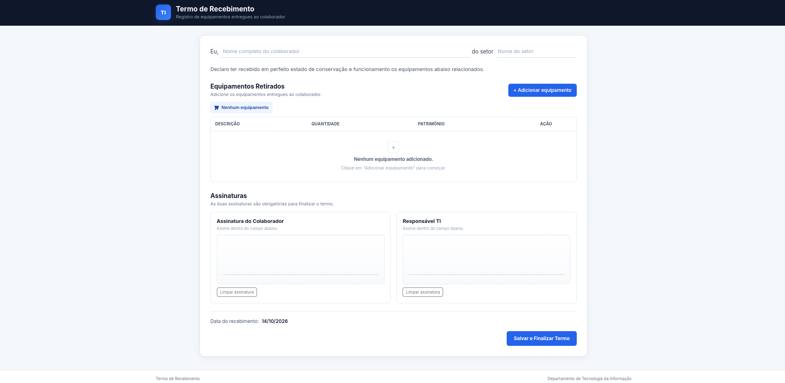
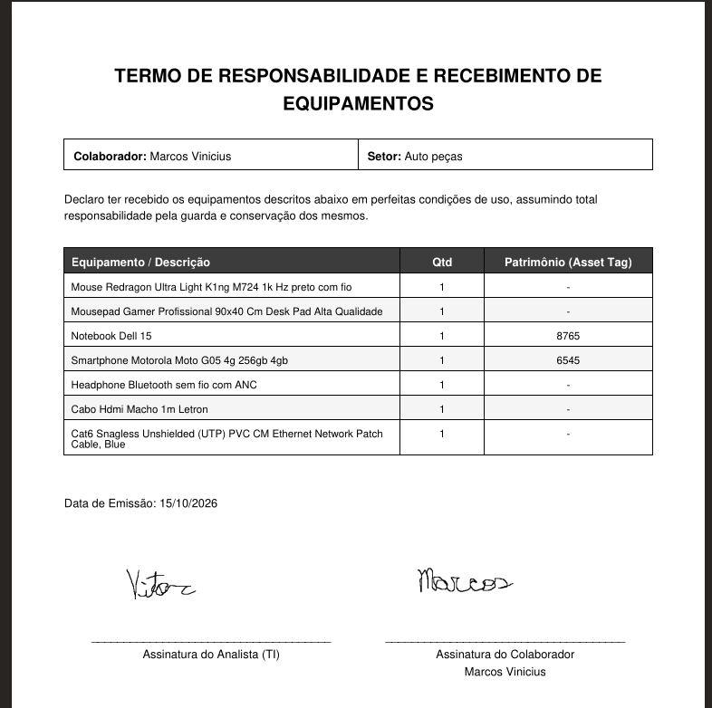

# FinaTermo

Sistema web para digitalização de termos de entrega e recebimento de equipamentos, com captura de assinaturas eletrônicas e geração automática de documentos PDF.

## Sobre o projeto

O **FinaTermo nasceu de uma necessidade real dentro de uma empresa**: substituir os termos impressos utilizados na entrega e no recebimento de equipamentos de Tecnologia da Informação por um processo digital.

A proposta foi desenvolver uma solução simples, prática e funcional para atender à rotina da equipe de TI, reduzindo o uso de papel e facilitando o registro das entregas, a coleta de assinaturas e o armazenamento dos documentos.

Em vez de começar com uma plataforma complexa, o sistema foi desenvolvido para resolver diretamente o problema existente, considerando o contexto de utilização, a infraestrutura disponível e o fluxo de trabalho da empresa.

A aplicação foi projetada para funcionar na rede corporativa (intranet), com utilização prevista em um tablet dedicado à equipe de TI. A interface pode ser adicionada à tela inicial do dispositivo, proporcionando uma experiência semelhante à de um aplicativo, sem a necessidade de desenvolver ou instalar um aplicativo nativo.

Embora o primeiro caso de uso esteja voltado à entrega de equipamentos de TI, a solução pode evoluir e ser adaptada para outros setores e processos que necessitem registrar entregas, identificar responsáveis e formalizar documentos por meio de assinaturas eletrônicas.

O projeto demonstra uma abordagem de desenvolvimento orientada a problemas reais: **resolver uma necessidade concreta de forma objetiva, entregar valor rapidamente e manter espaço para futuras evoluções.**

## Demonstração

Confira o funcionamento do FinaTermo, desde o preenchimento dos dados dos equipamentos até a captura das assinaturas e a geração do documento PDF.

🎥 **[Assistir à demonstração do FinaTermo](https://youtu.be/_Z4ZNK39ZsM)**

## Imagens do sistema

### Interface da aplicação



### Documento PDF gerado



## Funcionalidades

- Registro do responsável pelo recebimento e do respectivo setor.
- Inclusão dos equipamentos entregues, com nome, quantidade e número de patrimônio.
- Captura de assinaturas eletrônicas por meio de um canvas no frontend.
- Validação dos campos obrigatórios.
- Comunicação entre os serviços por meio de APIs REST e dados JSON.
- Geração automática de termos em PDF.
- Armazenamento dos documentos e das imagens das assinaturas.
- Identificação dos termos por UUID.
- Persistência dos arquivos utilizando Docker e bind mounts.

Quando um equipamento não possui número de patrimônio, o sistema utiliza `0000` como valor padrão, conforme a regra implementada na aplicação.

## Arquitetura

O FinaTermo utiliza uma arquitetura baseada em microsserviços, com componentes responsáveis pela descoberta de serviços, centralização de configurações, monitoramento e processamento dos documentos.

### Componentes principais

- **admin-server:** permite acompanhar a saúde e a disponibilidade das aplicações registradas, utilizando o Spring Boot Admin e as informações de descoberta de serviços.
- **discover-server:** realiza a descoberta dos serviços registrados, facilitando sua localização no ambiente distribuído.
- **config-server:** centraliza as configurações das aplicações, facilitando sua manutenção.
- **termo-ti:** recebe e processa os dados dos termos, incluindo informações do responsável, setor, equipamentos e assinaturas.
- **pdf-storage-Worker:** recebe os dados necessários para a geração dos documentos PDF e realiza o armazenamento dos arquivos gerados.

## Fluxo de funcionamento

1. A equipe de TI acessa o FinaTermo pela interface web.
2. O responsável preenche os dados do colaborador, do setor e dos equipamentos entregues.
3. As assinaturas são capturadas diretamente na interface, por meio de um canvas.
4. Os dados do termo e as imagens das assinaturas são enviados ao backend por rotas específicas.
5. O serviço processa as informações e cria uma estrutura de diretórios identificada pelo UUID do termo.
6. Os dados necessários à geração do documento são enviados ao worker em formato JSON.
7. O worker realiza tentativas de verificação da disponibilidade do diretório de destino, conforme a lógica implementada.
8. Após localizar o diretório, o worker gera o PDF e armazena o documento junto às imagens das assinaturas.
9. Os arquivos permanecem no ambiente de armazenamento configurado para a aplicação.

## Geração e armazenamento dos documentos

Cada termo possui um identificador único (UUID), utilizado para organizar o documento gerado e suas respectivas assinaturas.

A estrutura de armazenamento segue este modelo ilustrativo:

```text
uploads/
└── assinaturas/
    └── <UUID-do-termo>/
        ├── termo.pdf
        ├── assinatura_responsavel.png
        └── assinatura_responsavel_ti.png
```

Os nomes dos arquivos apresentados são ilustrativos e podem variar conforme a implementação.

O diretório `uploads` utiliza um **bind mount do Docker**, conectando uma pasta do ambiente hospedeiro a um diretório utilizado pelo container.

Exemplo de configuração:

```yaml
volumes:
  - ./uploads/assinaturas:/app/uploads/assinaturas
```

Essa configuração permite que os arquivos sejam mantidos fora da camada gravável do container e continuem disponíveis após sua recriação, desde que o diretório hospedeiro e os volumes estejam configurados corretamente.

Os documentos e as assinaturas devem ser armazenados com os controles de acesso e a proteção adequados, pois podem conter dados pessoais.

## Ambiente de execução e acesso

O FinaTermo foi concebido para operar em uma **intranet corporativa**, com os serviços executados em um servidor local da empresa.

- **Dispositivo principal:** tablet destinado à utilização pela equipe de TI.
- **Experiência web app:** possibilidade de adicionar a página à tela inicial do tablet.
- **Rede interna:** acesso por dispositivos autorizados conectados à rede corporativa.
- **Expansão de acesso:** possibilidade de utilização em computadores e celulares, conforme a configuração do ambiente.

Para acessar a aplicação a partir de outro dispositivo da rede, utilize o endereço IP local do servidor no lugar de `localhost`.

Exemplo:

```text
http://IP-DO-SERVIDOR:8080/index.html
```

O acesso depende da configuração dos serviços, das regras de rede e do firewall. Caso seja necessário acessar o sistema fora da empresa, poderá ser utilizada uma conexão autorizada à rede corporativa, como uma VPN, desde que o ambiente esteja preparado para isso.

## Tecnologias e conceitos

- **Java**
- **Spring Boot**
- **Spring Cloud**
- **Eureka Server** — descoberta de serviços
- **Spring Cloud Config Server** — centralização de configurações
- **Spring Boot Admin** — monitoramento de aplicações
- **APIs REST e JSON**
- **Arquitetura de microsserviços**
- **Processamento de documentos por worker**
- **Geração automática de PDF**
- **Captura de assinaturas por canvas**
- **UUID** — identificação dos termos
- **Docker e Docker Compose**
- **Volumes Docker e bind mounts**

## Como executar o projeto

### Pré-requisitos

- Docker instalado.
- Docker Compose disponível.
- Arquivo `.env` configurado com as variáveis necessárias para a execução dos serviços.

### 1. Clonar o repositório

```bash
git clone https://github.com/VitorFidelis/FinaTermo.git
cd FinaTermo
```

### 2. Configurar as variáveis de ambiente

Preencha o arquivo `.env` com as configurações exigidas pelo projeto.

Repositório disponibiliza um "`.env.example`", utilize-o como referência para criar seu arquivo .env local.

### 3. Iniciar os serviços

Na raiz do projeto, execute:

```bash
docker compose up --build
```

O comando constrói as imagens necessárias e inicia os containers definidos no `docker-compose.yml`.

### 4. Endereços de acesso

Após a inicialização, os serviços poderão ser acessados pelos endereços abaixo, desde que os respectivos containers e portas estejam configurados e ativos.

| Serviço | Endereço local |
|---|---|
| FinaTermo — Interface Web | http://localhost:8080/index.html |
| Swagger UI — Documentação da API | http://localhost:8080/swagger-ui.html |
| Spring Boot Admin — Monitoramento | http://localhost:9090 |
| Eureka Server — Descoberta de Serviços | http://localhost:8761/ |
| pgAdmin — Gerenciamento do banco | http://localhost:5050 |
| RabbitMQ Management — Gerenciamento de filas | http://localhost:15672 |

### 5. Encerrar os serviços

Para interromper e remover os containers, execute:

```bash
docker compose down
```

Os arquivos armazenados em diretórios persistentes, como PDFs e imagens de assinaturas, permanecem no ambiente hospedeiro conforme a configuração dos volumes.

## Possibilidades de evolução

O FinaTermo foi desenvolvido inicialmente para resolver uma necessidade específica, mas sua proposta pode ser ampliada conforme surgirem novas demandas.

Entre as possibilidades de evolução estão:

- Adaptação para outros setores e tipos de entrega.
- Inclusão de novos modelos de termos e documentos.
- Ampliação dos recursos de consulta e gerenciamento dos registros.
- Evolução dos perfis de acesso e das permissões.
- Implementação de novos fluxos de aprovação e formalização.
- Expansão da infraestrutura conforme a necessidade do negócio.

Essas possibilidades não representam necessariamente funcionalidades já implementadas, mas caminhos para a evolução do projeto.

## Considerações finais

O FinaTermo surgiu da necessidade de resolver um problema real do ambiente corporativo, utilizando tecnologia para simplificar uma atividade operacional e tornar o processo mais organizado.

Além de digitalizar os termos de entrega, o projeto permitiu trabalhar com desenvolvimento backend, integração entre microsserviços, descoberta de serviços, configuração centralizada, monitoramento, geração de documentos e persistência de arquivos em containers.

A proposta é mostrar que uma solução não precisa começar complexa para gerar valor: ela precisa atender bem à necessidade atual e permitir que novas funcionalidades sejam incorporadas conforme o projeto evolui.
